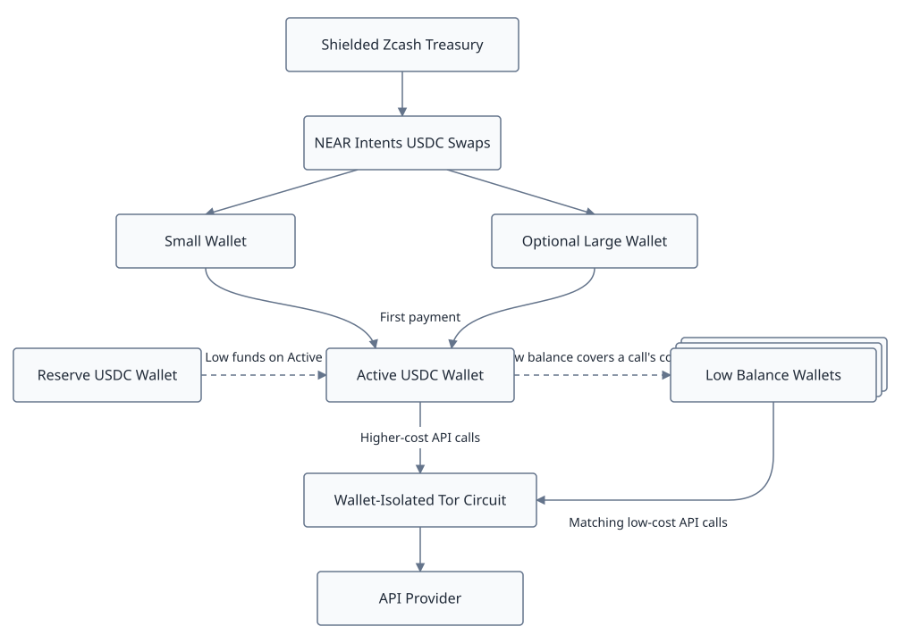

# x402_treazury

**Privacy-enhanced x402 payments for AI agents.**

[x402 micropayments](https://x402.org/) have a privacy problem. When you reuse your
payment wallet across multiple agents, your wallet source address lists all their API calls on
the public Base blockchain. Connecting directly to API services also exposes your
network address to these API providers and to Coinbase infrastructure.

**x402_treazury** reduces that linkability with **Zcash-funded rotating wallets** and **Tor isolation tied to each payment identity**. You choose which providers share a wallet and which stay separate.

The `x402_treazury` cli tool loads x402 provider API catalogs, converts them into
MCP tools, handles x402 payments, and replenishes Base USDC wallets, without giving the agent spending keys. One Rust process can serve multiple authenticated MCP endpoints with different tools and wallet groups, all filled from the same Zcash treasury wallet.

You can also optionally grant your agent a set of tools to discover and add x402 providers themselves, and as a separate additonal option, to send and receive cryptocurrency on any blockchain supported by Near Intents, using shielded ZEC swaps.

You can set custom financial limits on all of these transactions.

## How it works



> **NOTE: Payments are not invisible**
>
> `x402_treazury` reduces wallet and network linkability; it does not make payments
> invisible. The Zcash to USDC funding path uses **public NEAR swaps and public Base
> transactions**. These are visible, but unlinkable to your Zcash shielded
> address. Because of the Near Intents ~$2 minimum swap size, each wallet will make
> multiple API calls before rotation. Timing correlation and identifying request
> contents across wallet rotations can also link activity. x402_treazury schedules
> wallet rotation swaps to decouple their execution from prior transactions, but
> if Near Intents USDC swap volume is extremely low, this correlation will be easier.
> You can also bind independent wallet groups to specific API collections, to reduce
> content linkability.

Each managed wallet group uses one small (~$2.50 USDC) wallet pair, and an
optional custom-denomination large wallet pair.

Every wallet group always maintains as least two USDC wallet addresses to ensure
that no x402 calls are blocked or delayed by refill swaps: one active USDC
wallet, one fully-funded reserve USDC wallet, and a collection of previously
used low-balance wallets. Thus, even though Near Intents swaps can take some
minutes to settle, your agent never notices, nor do you experience any delays.

API catalog pricing data and cached paid API prices are used to choose the
smallest sufficient USDC wallet address from a wallet group for each paid x402
request. ZEC-to-USDC swaps are scheduled on a randomized timer (30-120 seconds) to
create a new wallet address when one of the wallets in a group drops below a
randomized threshold (5-25%) of its initial value.

If Tor is in use by x402_treazury, then payment requests, wallet-specific
balance checks, and swap jobs all use the current payer wallet address as the
Tor circuit isolation identity. Switching payers changes the Tor isolation
identity. API catalog retrieval and llm help text use separate Tor identities
isolated by the domain of the destination.  Zcash treasury synchronization has
its own Tor identity and isolation. Tor mode uses remote DNS and has no
direct-network fallback. If you [enable direct Zcash payments and swap tools](docs/configuration.md#direct-swap-control) for your agent, each swap is
isolated to a separate Tor circuit.

The CLI uses explicit commands: `serve` starts MCP endpoint serving, `catalog
tools` inspects API inventories, `catalog warm` caches the API catalog, `wallet`
manages the ZEC treasury and USDC wallet groups, `sources inspect` reads
persisted agent-added sources. Running `x402_treazury` without a command shows
help. See the [command reference](docs/configuration.md).

## Choose a deployment

| Path | Best for | Network | Starting cost |
| --- | --- | --- | --- |
| [Managed starter](examples/deployments/managed.toml) | Learning the model and making a first paid call | Direct | One $5 ZEC allocation |
| [Research desk](examples/deployments/research_desk.toml) | Multi-domain research with task-oriented endpoints | Tor | One $5 ZEC allocation to start; fully funding all four independent wallet groups takes ~$20. |
| [Private Hermes](https://github.com/mikeperry-tor/private-hermes-agent) | A complete packaged private Hermes Agent stack | Tor-routed TEE-verified private agent use | Same as Research Desk (uses this config by default) |

The managed starter is the smallest readable configuration: one listener, one
wallet group and one source. The research desk is the full selection described in
[README_ADVANCED.md](README_ADVANCED.md). `comprehensive.toml` remains a smaller
multi-listener example documented there.

[Private Hermes](https://github.com/mikeperry-tor/private-hermes-agent) is
maintained separately. It packages Hermes Agent, Tor-routed egress,
validated TEE confidential inference, a code executor, and this project.
It adds its own requirements (Docker Engine 28+ with Linux containers, Compose
2.36+, make, Python 3), and it pins the versions of each componentt. Stack and
packaging issues belong there, and x402_treazury issues belong here.

For the research desk, `$5 to start` means one initial bootstrap allocation; all APIs will work, but all will share an initial bootstrap wallet.

## Quickstart: Z-Cash Wallet with Dynamically Managed Tools

The [managed starter](examples/deployments/managed.toml) exposes Exa web search,
page contents and provider-management tools on `http://127.0.0.1:8000/mcp`, backed
by one rotating wallet pool. Agents can
[add public APIs](docs/agent-sources.md#agent-tools) that use that same pool;
API registrations last until the process exits. Exa's catalog loads from its public
OpenAPI specification; no Exa API key is required.

```sh
make build
cp examples/deployments/managed.toml examples/deployments/managed.local.toml
```

Initialize its treasury explicitly, then start the authenticated listener:

```sh
export X402_TREAZURY_CONFIG="examples/deployments/managed.local.toml"
export X402_TREAZURY_MCP_TOKEN="replace_with_a_secret_bearer_token"
target/release/x402_treazury wallet init
target/release/x402_treazury serve
```

`X402_TREAZURY_CONFIG` supplies the deployment file for serving, wallet, catalog,
config and source commands. An explicit `--config FILE` overrides it. Export it
in each terminal where you run commands. Unset it for standalone `--provider`
commands or wallet commands using `--state-dir`.

The example listeners require `X402_TREAZURY_MCP_TOKEN`; missing, empty and
whitespace-only values fail startup. To allow unauthenticated access explicitly,
set `auth = false` and omit `bearer_token_env` on that listener. Host checking must
remain enabled when authentication is disabled.

Send $5 worth of ZEC to the shielded receive address printed by initialization to cover
the $3 upper initial nominal USDC bound plus source fees and bridge costs. Keep
additional funds for future replacements. Each x402 API payment is capped at
$0.50. Funding starts after the listener binds, so tools remain visible while
funding is pending. Connect your MCP client with
`Authorization: Bearer <your X402_TREAZURY_MCP_TOKEN>`.

To serve over Tor instead, start Tor Browser with its SOCKS listener at
`127.0.0.1:9150` and pass [the Tor and discovery-relay settings](examples/network/tor.toml):

```sh
target/release/x402_treazury serve \
  --network-config examples/network/tor.toml
```

`--network-config` replaces the complete `[network]` policy and, when present,
`[relay_fallback]` for that invocation. This Tor example enables configured paid
relay fallback for catalog, document reads and built-in directory/Coinbase searches
using the deployment's existing payers. Actual API fallback requires explicit
`api_requests = true`. Without the option, the managed starter uses its own
settings. For treasury initialization over Tor, pass the same option to
`wallet init`, or initialize using a deployment with the embedded policy.

The default key file lives with treasury state at `state/managed/wallet.key`;
protect that directory because it contains both state and decryption material.
Run one serving process per treasury.

`x402_treazury wallet status`
reads saved status alongside serving;
other exclusive wallet administration requires stopping it. See
[wallet administration](docs/wallet-cli.md) and the
[example choices](examples/README.md).

## Going further

- [Advanced deployments](README_ADVANCED.md): research desk and comprehensive walkthroughs, Tor, bootstrap and relay details.
- [Large reserves and expensive APIs](docs/configuration.md#reserve-sizing-and-fragmentation): sizing, fragmentation and the separate large-wallet rationale.
- [Wallet sharing and automatic assignment](docs/configuration.md#multiple-mcp-ports-from-one-configuration): templates, scopes and examples.
- [Agent Zcash payments and swaps](docs/configuration.md#direct-swap-control): optional receive/send tools and limits.
- [Agent-added API providers](docs/agent-sources.md#agent-tools): discovery, registration and direct calls.
- [Wallet CLI](docs/wallet-cli.md): treasury operations, funding limits and recovery.

## Adding API Providers

The [provider catalog](providers/README.md) contains reusable TOML definitions,
including curated catalogs for APIs that need adaptation. Providers carry specific
reliability tags for observed issues, including Tor-related failures; startup prints
corresponding warnings. Tags describe known observations, not current availability
or proof that Tor caused a failure.

For a compatible OpenAPI provider, a source can start with just its specification URL:

```toml
[sources.my_api]
spec = "https://api.example.com/openapi.json"
```

Add `my_api` to a server's `sources`. Some providers also need a `base_url`, tool
filters, schema overrides or payment compatibility settings. Reuse bundled settings
with `extends = "../providers/exa.toml"`; add a `help_url` for a single usage guide.
Use `catalog tags` and `catalog tools` to choose a useful subset instead of exposing an
entire large catalog to the agent.

For large catalogs, set `discover_on_demand = true` under `[servers.NAME]` to provide the agent with search+call wrapper tools instead of every API schema. Agents retrieve full
descriptions and schemas as needed via the `x402_treazury_tools_search()` tool, and can
make calls to discovered tools via the `x402_treazury_tool_call()` tool.
See [on-demand discovery](docs/agent-sources.md).

Provider management lets agents find bundled providers or APIs through
[x402 List](https://x402-list.com) and Coinbase resource search, then add tools to an
MCP endpoint themselves. The feature is disabled by default; enable local
management, remote management and raw URL calls independently on an endpoint with
an explicit existing `wallet`. Optional `source_registry_file` enables persistence.
Agent tools cannot change configured API sources, wallet settings or spending
limits. See [configuration and authority](docs/agent-sources.md#configuration-and-authority)
and the [agent tool table](docs/agent-sources.md#agent-tools).

## Experimental HTTP/2 cover traffic

Tor mode enables bounded unsigned range traffic by default for eligible configured
sources. Explicit profiles can add randomized request-header padding and tune
concurrency and sampling distributions. This is a
research vehicle for traffic-shape experiments, **not a demonstrated defense against
traffic analysis**. It shares the real request's isolation scope and prioritizes paid
traffic.

Set `network.cover_traffic_enabled = false` to disable it globally, or
`cover_traffic_enabled = false` in a provider/source definition to disable it for that
provider. Some bundled providers already opt out for compatibility. Agent-added
sources do not automatically authorize cover traffic. See the
[cover traffic guide](docs/cover-traffic.md) for distributions, bounds and qualification.

## Documentation and status

| Guide | What it covers |
| --- | --- |
| [Advanced deployments](README_ADVANCED.md) | Research desk, comprehensive example, Tor and bootstrap walkthroughs |
| [Examples](examples/README.md) | Deployment choices, wallet groups, ports and source selections |
| [Configuration](docs/configuration.md) | Sources, listeners, filters, pricing and transport options |
| [Wallet CLI](docs/wallet-cli.md) | Treasury operations, funding limits and recovery |
| [Wallet rotation](docs/wallet-rotation.md) | Admission, reserve claims, retained capacity and durable accounting |
| [Network isolation](docs/network-egress.md) | Tor identities, connection pools and egress boundaries |
| [Provider caveats](providers/CAVEATS.md) | Current provider support boundaries and uncertainty |
| [Development](docs/development.md) | Tests, coverage and complexity tools |
| [Documentation index](docs/README.md) | Architecture, demos, plans and further references |

Common development commands run from the repository root:

| Command | Purpose |
| --- | --- |
| `make` / `make build` | Optimized release build |
| `make build-dev` | Incremental development build |
| `make test` | Default test suite |
| `make cargo-check` | Fast compilation check |
| `make fmt` / `make fmt-check` | Apply / check formatting |
| `make clippy` | Clippy with warnings denied |
| `make check` | Full ordered development checks |
| `make coverage` | Default coverage report |
| `make help` | All entrypoints and argument examples |

See the [entrypoint reference](scripts/README.md) for prerequisites, focused tests
and optional coverage modes. Run `make check` for the full offline test suite.
Live tests are separately funded and opt-in; ordinary tests use temporary state and unfunded fixture keys.

## Related projects

`x402_treazury` exposes existing Base USDC x402 APIs as MCP tools, with
Zcash-funded wallet rotation and optional Tor isolation. API Providers receive ordinary
x402 payments without integrating a new privacy scheme; the Base payments remain
public.

These projects explore related approaches to private API access:

| Project | Approach and comparison |
| --- | --- |
| [CipherPay](https://github.com/atmospherelabs-dev/cipherpay-x402) | Middleware for accepting shielded ZEC payments through x402 and MPP. API Providers must integrate Zcash payment acceptance to be used with it; x402_treazury uses Zcash to fund rotating Base USDC wallets for existing x402 providers. |
| [zimppy](https://github.com/betterclever/zimppy) | Zcash wallet and Rust/TypeScript SDKs implementing the Machine Payments Protocol (MPP), including prepaid sessions and an MCP example. Related through Zcash and agent tooling, it requires API servers supporting its Zcash payment method. |
| [SecretPay](https://github.com/DVB-ANRS/SecretPay) | A hackathon prototype using Unlink privacy pools and disposable wallets to make ordinary x402 payments on Base Sepolia. Its gateway and wallet approach is close to x402_treazury's, but uses a different funding mechanism; its documented direct-transfer funding fallback can expose the funding link. |
| [Galactica aztec-x402](https://github.com/Galactica-corp/aztec-x402) | Client and server tooling for private x402 settlement on Aztec, with a public-testnet demo. API Providers must integrate the Aztec payment flow to be used; x402_treazury retains existing Base USDC settlement and reduces linkability through funding, wallet rotation and network isolation. |
| [PrivAgent](https://github.com/Himess/privagent) | A shielded-pool payment protocol on Base with x402 middleware and client tooling. It brings privacy into settlement through a custom protocol that API providers must integrate; x402_treazury keeps ordinary public Base USDC payments. |
| [zkAPI](https://blog.ethereum.org/2026/10/01/introducing-zkapi) | Private usage credits backed by zero-knowledge proofs, with temporary capped API keys for metered usage. It separates payment identity from API usage through a credit/session model. Network anonymity and request-content correlation remain separate concerns. |

## License

AGPL-3.0. See [LICENSE](LICENSE) and [CONTRIBUTING.md](CONTRIBUTING.md).

Dual licensing available.
