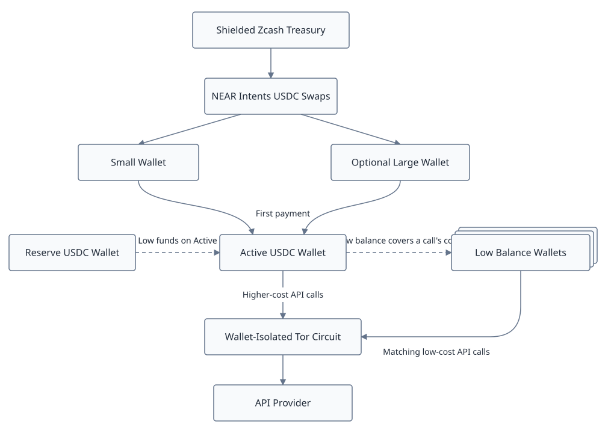

# x402_treazury

[](https://github.com/mikeperry-tor/x402_treazury/actions/workflows/ci.yml)
[](docs/testing.md#github-actions-and-coverage)

**Privacy-enhanced x402 payments for AI agents.**

[x402 micropayments](https://x402.org/) have a privacy problem. When you reuse a
payment wallet across multiple agents, that wallet address lists all their API
calls on the public Base blockchain. Connecting directly to API services also
exposes your network address to API providers and to Coinbase infrastructure.

**x402_treazury** reduces that linkability with **Zcash-funded rotating wallets**
and **Tor isolation tied to each payment identity**. You choose which providers
share a wallet and which stay separate.

The `x402_treazury` CLI loads x402 provider API catalogs, converts them into MCP
tools, handles x402 payments, and replenishes Base USDC wallets without giving
the agent spending keys. One Rust process can serve multiple authenticated MCP
endpoints with different tools and wallet groups, all funded from the same Zcash
treasury wallet.

You can also optionally grant your agent tools to discover and add x402
providers on its own, and separately let it send and receive cryptocurrency on
any blockchain supported by NEAR Intents using shielded ZEC swaps. You can set
custom financial limits on all of these transactions.

## How it works



> **NOTE: Payments are not invisible**
>
> `x402_treazury` reduces wallet and network linkability; it does not make
> payments invisible. The Zcash-to-USDC funding path uses **public NEAR swaps
> and public Base transactions**. These are visible on-chain, though unlinkable
> to your Zcash shielded address.
>
> Because of the NEAR Intents ~$2 minimum swap size, each wallet makes multiple
> API calls before rotation. Timing correlation and identifying request contents
> across wallet rotations can also link activity. `x402_treazury` schedules
> wallet rotation swaps to decouple them from prior transactions, but correlation
> betweem separate USDC addresses may still be accurate whenever NEAR Intents
> USDC swap volume is extremely low. On the flip side, the more users of
> x402_treazury there are, the lower this linkability will be, even if
> other NEAR USDC swap volume is low.
>
> To reduce content linkability, bind independent wallet groups to separate
> API collections. The
> [Research Desk](./README_ADVANCED.md#research-desk-walkthrough) example
> deployment uses wallet group separation to isolate research categories.

Each managed wallet group uses a small (~$2.50 USDC) wallet pair and an optional
custom-denomination large wallet pair.

An initial bootstrap starts with one funded wallet, and first use triggers the
second. In steady state, every active wallet group maintains at two or more USDC
addresses: one active USDC wallet, one funded reserve USDC wallet, and
previously used low-balance wallets. API catalog pricing and cached API prices
guide selection of the smallest sufficient USDC wallet in a group for each paid
x402 request.

This ensures that x402 calls are never blocked or delayed by refill swaps. Even
though NEAR Intents swaps take several minutes to settle, your agent does not
wait on them.

The ZEC-to-USDC wallet fill swaps also run on a randomized 30-120 second timer
to fund a replacement address once a wallet drops below a randomized 5-25%
threshold of its initial value. This early swap trigger combined with a delay
helps to reduce linkability between a new wallet fill and previous wallet use.

> **NOTE:** I have not yet done analysis of Near USDC swap volume; if it
> is extremely low in the $2-3 range, these delays may need to be increased.
> Conversely, the more users of x402_treazury exist, the shorter these delays
> will need to be.

When Tor is enabled, payment requests, wallet-specific balance checks, and swap
jobs all use the payer wallet address as their Tor circuit isolation identity,
so switching payers switches circuits. API catalog fetches and LLM help text use
separate Tor identities isolated by destination domain, and Zcash treasury sync
uses its own Tor identity. Tor mode uses remote DNS with no direct fallback. If
you [enable direct Zcash payments and swap tools](docs/configuration.md#direct-swap-control),
each swap uses its own Tor circuit.

The CLI provides explicit subcommands:

- `serve`: start MCP endpoints and background wallet funding.
- `catalog tools` and `catalog warm`: inspect or cache API catalogs.
- `wallet`: manage the ZEC treasury and USDC wallet groups.
- `sources inspect`: inspect persisted agent-added sources.

Run `x402_treazury` with no arguments for help, or see the
[command-line guide](docs/usage/cli.md) and
[configuration reference](docs/configuration.md).

## Choose a deployment

| Path | Best for | Network | Starting cost |
| --- | --- | --- | --- |
| [Managed starter](examples/deployments/managed.toml) | Learning the model and making a first paid call | Direct | One $5 ZEC deposit |
| [Research desk](examples/deployments/research_desk.toml) | Multi-domain research with task-oriented endpoints | Tor | One $5 ZEC deposit to start; funding all four wallet groups takes ~$20 |
| [Private Hermes](https://github.com/mikeperry-tor/private-hermes-agent) | A complete packaged private Hermes Agent stack | Tor-routed, TEE-verified private agent use | Same as Research Desk (uses this config by default) |

The managed starter is the smallest deployment: one listener, one wallet group,
and one source. The research desk is the full multi-endpoint setup covered in
[README_ADVANCED.md](README_ADVANCED.md), which also documents the smaller
`comprehensive.toml` multi-listener example.

For the research desk, "$5 to start" covers the initial bootstrap allocation;
all APIs work right away, sharing the bootstrap wallet until each group funds
its own wallet on first use.

[Private Hermes](https://github.com/mikeperry-tor/private-hermes-agent) is
maintained in a separate repository. It packages Hermes Agent, Tor-routed
egress, TEE-verified confidential inference, a code executor, and
`x402_treazury`. It adds its own prerequisites (Docker Engine 28+ with Linux
containers or rootless Podman 5.4+ on Linux, Compose 2.36+, Make, and Python 3)
and pins component versions. Report stack and packaging issues there, and
`x402_treazury` issues here.

## Quickstart: Z-Cash Wallet with Dynamically Managed Tools

The [managed starter](examples/deployments/managed.toml) exposes Exa web search,
page contents, and provider-management tools on `http://127.0.0.1:8000/mcp`,
backed by one rotating wallet pool. Agents can
[add public APIs](docs/agent-sources.md#agent-tools) using that pool; dynamic
registrations last until the process exits. Exa's catalog loads from its public
OpenAPI specification with no Exa API key.

```sh
make build
cp examples/deployments/managed.toml examples/deployments/managed.local.toml
```

Initialize the treasury, then start the authenticated listener:

```sh
export X402_TREAZURY_CONFIG="examples/deployments/managed.local.toml"
export X402_TREAZURY_MCP_TOKEN="replace_with_a_secret_bearer_token"
target/release/x402_treazury wallet init
target/release/x402_treazury serve
```

`X402_TREAZURY_CONFIG` sets the default deployment file for `serve`, `wallet`,
`catalog`, `config`, and `sources` commands, and `--config FILE` overrides it.
Export it in each terminal where you run commands, and unset it when running
standalone `--provider` commands or wallet commands with `--state-dir`.

The example listeners require `X402_TREAZURY_MCP_TOKEN`; missing, empty, or
whitespace-only values fail startup. To disable authentication, set
`auth = false` and omit `bearer_token_env` on that listener. Keep Host header
checking enabled when authentication is off so web pages in your browser cannot
reach local MCP endpoints.

Send $5 of ZEC to the shielded receive address printed by `wallet init`. That
covers the $3 upper nominal USDC target plus network and bridge fees; add more
ZEC for later rotations. Each x402 API payment is capped at $0.50.

Background funding starts after the listener binds, so tools remain visible
while funding completes. Connect your MCP client with
`Authorization: Bearer <your X402_TREAZURY_MCP_TOKEN>`.

### Running over Tor

To route traffic through Tor, start Tor Browser with its SOCKS listener at
`127.0.0.1:9150` and pass
[the Tor and discovery-relay settings](examples/network/tor.toml):

```sh
target/release/x402_treazury serve \
  --network-config examples/network/tor.toml
```

`--network-config` replaces the deployment's `[network]` table (and
`[relay_fallback]` when present) for that command. For treasury initialization
over Tor, pass the same flag to `wallet init`, or initialize against a
deployment that embeds Tor settings.

`examples/network/tor.toml` enables a paid relay fallback for catalog fetches
and provider directory searches using the deployment's wallets. If a provider or
directory blocks Tor (captcha, HTTP 429, HTTP 503, or similar) across three
separate Tor circuits, `x402_treazury` tries each configured fallback relay in
order. The Tor network example and both Tor deployments use the same relay
order. See [example relay settings](examples/README.md#operator-notes).

When a provider directory search falls back to a paid relay due to rate limits
or bans (most common with Coinbase), the relay provider receives the search
text in the target URL.  `source_discovery` controls this fallback.
`api_requests` controls fallback for provider tool calls and raw URL calls and
defaults to `false`. See the [relay trust
boundary](docs/network-egress.md#relay-fallback).

### Wallet state and concurrency

The wallet key file lives alongside treasury state at `state/managed/wallet.key`.
Protect that directory because it contains both wallet state and the decryption
key.

Run only one `serve` process per state directory. Read-only wallet commands
(`wallet status`, `wallet addresses`, `wallet notes`, and `wallet preview`)
work while `serve` is running; exclusive commands (such as `wallet sync`,
`wallet backup`, `wallet rename`, and `wallet bootstrap`) require stopping
`serve` first. See [wallet administration](docs/wallet-cli.md) and
[example choices](examples/README.md) for details.

## API discovery and provider management

In addition to example deployments that provide curated tool selections,
`x402_treazury` also supports the ability for an agent to discover and add
arbitrary x402 providers and perform raw tool calls directly. The `provider_management_local` endpoint option allows the agent to add tools from
the set of [bundled API providers](./providers/README.md); the `provider_management_remote` endpoint option allows the agent to add remote
providers using the an `openapi.json` API specification URL for that provider.

> The bundled providers collection exists because many providers are not fully
> compliant with the OpenAPI specification and require various forms of schema
> and/or tool description repair; irreparably broken tools are excluded in these
> files. If your agent registers a remote `openapi.json` URL that matches one
> of the bundled provider definitions, these repairs will be applied to that
> schema automatically.

Choose which [remote API directories](docs/agent-sources.md#external-directory-matching)
the endpoint searches with `remote_provider_directories`. Enable
`raw_url_calls` to let agents call documented HTTPS APIs directly.

| Tool | Enabled by | What the agent uses it for |
| --- | --- | --- |
| `providers_list_local` | `provider_management_local = true` | Finds bundled provider definitions offline, with optional `q`, `page`, and `per_page`. |
| `providers_add_local` | `provider_management_local = true` | Registers a bundled provider by exact `provider_id`, with optional `name`. |
| `providers_search_remote` | `provider_management_remote = true` plus `remote_provider_directories` | Searches the configured directories for APIs. |
| `providers_add_remote` | `provider_management_remote = true` | Registers a public HTTPS OpenAPI 3 JSON specification by `spec_url`, with optional `name`. |
| `provider_details_remote` | `provider_management_remote = true` | Locates specs or help from `base_url`, reads usage text from `documentation_url`, or looks up an `x402_list_id` when `x402-list` is enabled. |
| `raw_call` | `raw_url_calls = true` | Calls a documented public HTTPS URL with `method`, `url`, and optional `query`, `headers`, and JSON `body`. |

> All built-in tools are prefixed with `x402_treazury_`, to avoid tool
> collision and/or confusion with provider APIs. The tool tables in this README
> show names without this prefix.

Agent-added tool registrations belong only to the endpoint that created them and last
until the process exits unless you set `source_registry_file`. Payment caps and
endpoint tool filters still apply.

Set `discover_on_demand = true` on an endpoint with a large catalog to keep
provider API definitions out of the advertised tool list. The endpoint
also exposes two wrapper tools so the agent retrieves schemas only when needed:

| Tool | What the agent uses it for |
| --- | --- |
| `tools_search` | Finds callable tools and their full input schemas on this endpoint (`query`, `source_name`, `cursor`, and `limit`). Makes no provider requests. |
| `tool_call` | Invokes a discovered `tool_id` with `arguments`; payment checks still apply. |

These two wrapper tools are also advertised whenever either provider-management
flag is enabled so the agent can find and call newly registered APIs. On-demand
discovery changes only tool advertising; catalogs still load and direct calls
still work, though most agent frameworks require using the wrapper tools for
unadvertised tools. See [agent source management](docs/agent-sources.md) for
directory behavior, naming, and persistence.

> **NOTE**: The `toolbox` endpoint in
> [`examples/deployments/research_desk.toml`](./examples/deployments/research_desk.toml)
> enables all of these forms of tool discovery by default. See the
> [research desk walkthrough](./README_ADVANCED.md#research-desk-walkthrough)
> for more details about this configuration file.

## Enabling Direct Cryptocurrency Transactions

You can optionally let agents receive payments into the Zcash treasury and send
ZEC or foreign assets from it. These tools are off by default. Native ZEC
transfers use shielded Ironwood transactions; foreign assets use NEAR swaps.

This requires an initialized `[treasury]` and an authenticated MCP endpoint
(`auth = true`). Add this block to your deployment file, replacing `research`
with your endpoint name (`research` in the quickstart, `toolbox` in the research
desk):

```toml
[servers.research.swap_control]
receive = true
send = true
max_send_zec = "0.05" # Optional per-send ZEC limit, including the network fee.
```

You can enable `receive` and `send` independently. `max_send_zec` caps each
outgoing send or swap through these tools; it does not affect managed wallet
funding, incoming swaps, or other ZEC usage. Omit it or set it to `"none"` for
no per-send cap.

Native ZEC transfers need no NEAR setup; foreign assets require the
[NEAR swap settings](docs/configuration.md#direct-swap-control) under
`[funding]`. Start or restart `serve` to expose the tools.

| Tool | Enabled by | What it does |
| --- | --- | --- |
| `swap_assets` | Either flag | Searches native ZEC and supported foreign assets by symbol, chain, or keywords. |
| `payment_request_create` | `receive` | Creates a fresh shielded ZEC receive address or a single-use foreign swap deposit request. |
| `swap_preview` | `send` | Previews an outgoing payment and checks whether its estimated total fits `max_send_zec` and spendable ZEC. |
| `swap_send` | `send` | Sends native ZEC or swaps treasury ZEC for a requested foreign amount. |
| `swap_status` | Either flag; retained for persisted requests | Checks sent payments or receive requests, including UTC time and expiry countdowns. |

The tool descriptions tell the agent the usage rules for these tools. In
particular, foreign payers must send the **exact requested amount** (with
network fees and any memo added), and agents must never reuse a foreign swap
receive address: each payment needs a new `x402_treazury_payment_request_create`
call and a fresh quote and address. Native ZEC addresses may be reused, partial
ZEC receipts accumulate toward the requested amount, and persisted requests stay
visible through `x402_treazury_swap_status` even after new sends or receives are
disabled.

Even so, reinforce these rules in your system prompts for agents doing frequent
cryptocurrency transfers. LLMs typically assign lower priority to tool
descriptions than to prompts and direct user requests. See the
[direct swap control reference](docs/configuration.md#direct-swap-control) for
parameters and timing details.

> **NOTE**: Even with tool descriptions, spend limits, and careful prompting,
> these tools carry [serious risk](https://github.com/mikeperry-tor/HostileShop/)
> from prompt injection and cryptocurrency scams. Do not hold large amounts of
> ZEC in an agent's treasury, and instruct it to regularly send earned ZEC to
> an offline ZEC wallet address or to a wallet you control exclusively.

## Going further

- [Advanced deployments](README_ADVANCED.md): multi-listener walkthroughs, Tor,
  bootstrap, relay fallback, and adding providers.
- [Command-line guide](docs/usage/cli.md): setup, wallet management, inspection,
  and recovery workflows.
- [Configuration guide](docs/usage/configuration.md): operator choices for
  listeners, sources, wallets, Tor, and relay fallback.
- [Large reserves and expensive APIs](docs/usage/configuration.md#small-and-large-reserves):
  sizing, fragmentation, and when to add a large reserve.
- [Wallet sharing and automatic assignment](docs/usage/configuration.md#reusing-one-policy-across-many-groups):
  templates, scopes, and examples.
- [Sharing a payer during first use](docs/usage/configuration.md#sharing-a-payer-during-first-use):
  bootstrap groups and deferred funding.

## Developer documentation

| Guide | What it covers |
| --- | --- |
| [Documentation index](docs/README.md) | Architecture, demos, plans, and technical references |
| [Framework integration](docs/framework-integration.md) | Catalog warming JSON, degraded coverage, and endpoint readiness |
| [Provider caveats](providers/CAVEATS.md) | Provider support boundaries and open limits |
| [Wallet rotation](docs/wallet-rotation.md) | Payment selection, funding, rotation, and recovery |
| [Network isolation](docs/network-egress.md) | Tor identities, connection pools, and egress rules |
| [Developer orientation](docs/development.md) | Platform support, tests, diagnostic logs, coverage, and complexity tools |

Common development commands run from the repository root:

| Command | Purpose |
| --- | --- |
| `make` or `make build` | Optimized release build |
| `make build-dev` | Incremental development build |
| `make test` | Default test suite |
| `make cargo-check` | Fast compilation check |
| `make fmt` or `make fmt-check` | Apply or check formatting |
| `make clippy` | Clippy with warnings denied |
| `make check` | Full ordered development checks |
| `make coverage` | Default coverage report |
| `make help` | All entrypoints and argument examples |

See the [entrypoint reference](scripts/README.md) for prerequisites, focused
tests, and optional coverage modes. Run `make check` for the full offline test
suite. Live tests are separately funded and opt-in; offline tests use temporary
state and unfunded fixture keys.

## Related projects

`x402_treazury` exposes existing Base USDC x402 APIs as MCP tools with
Zcash-funded wallet rotation and optional Tor isolation. API providers receive
standard x402 payments on public Base without integrating a new privacy
protocol.

These projects explore related approaches to private API access:

| Project | Approach | Comparison to `x402_treazury` |
| --- | --- | --- |
| [CipherPay](https://github.com/atmospherelabs-dev/cipherpay-x402) | Middleware for accepting shielded ZEC payments through x402 and MPP. | API providers must integrate Zcash acceptance. `x402_treazury` uses Zcash to fund rotating Base USDC wallets for existing x402 providers. |
| [zimppy](https://github.com/betterclever/zimppy) | Zcash wallet and Rust and TypeScript SDKs implementing the Machine Payments Protocol (MPP), including prepaid sessions and an MCP example. | Requires API servers that support its Zcash payment method. `x402_treazury` works with existing Base USDC x402 APIs. |
| [SecretPay](https://github.com/DVB-ANRS/SecretPay) | Hackathon prototype using Unlink privacy pools and single-use wallets for Base Sepolia x402 payments. | Uses a similar gateway and wallet model. Its funding mechanism has a direct-transfer fallback that can expose the funding link. |
| [Galactica aztec-x402](https://github.com/Galactica-corp/aztec-x402) | Client and server tooling for private x402 settlement on Aztec, with a public-testnet demo. | API providers must integrate Aztec. `x402_treazury` keeps standard Base USDC settlement and reduces linkability through funding, rotation, and network isolation. |
| [PrivAgent](https://github.com/Himess/privagent) | Shielded-pool payment protocol on Base with x402 middleware and client tooling. | Providers must adopt its custom settlement protocol. `x402_treazury` keeps standard public Base USDC payments. |
| [zkAPI](https://blog.ethereum.org/2026/10/01/introducing-zkapi) | Private usage credits backed by zero-knowledge proofs, with temporary capped API keys for metered usage. Network anonymity and request-content correlation remain separate concerns for zkAPI. | zkAPI separates payment identity from API usage through credits and sessions. `x402_treazury` uses the provider's per-request x402 challenge. |

## License

AGPL-3.0. See [LICENSE](LICENSE) and [CONTRIBUTING.md](CONTRIBUTING.md).

Dual licensing available.
